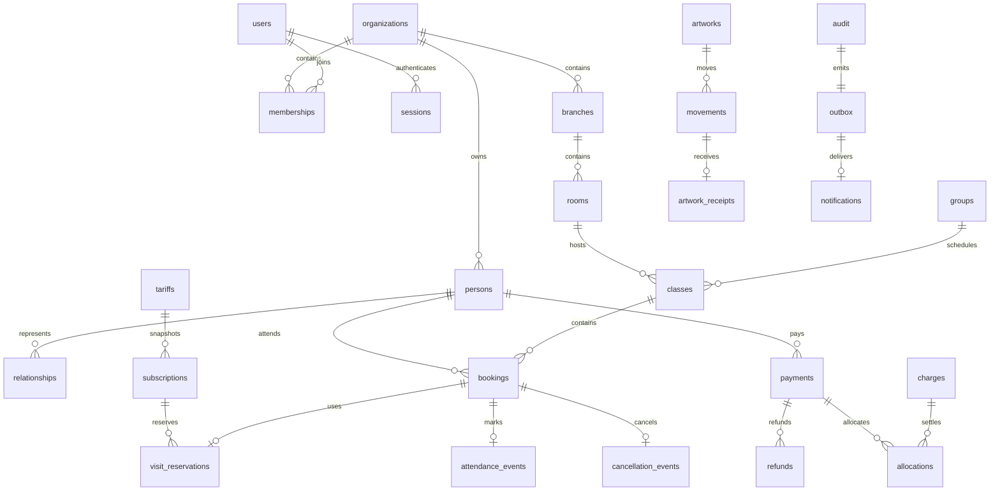

# Схема тестовой реализации

Бизнес-связи используют `(org,id)` и составные внешние ключи, исключающие межорганизационную связь. Идентификаторы сущностей UUID, событий outbox/audit — bigint. Денежные суммы bigint в минимальных единицах; API ограничивает безопасный целочисленный диапазон JSON. Время — timestamptz; филиал дополнительно хранит IANA timezone. Имена/контакты PII, bcrypt hash/хеш токена — секретные данные; их нет в audit. Организации изолированы запросами application, PostgreSQL RLS пока отсутствует.

Источники схемы — последовательные SQL-файлы backend/db/migrations. В production нужны отдельные DB-роли migrator/runtime и внешняя защита аудита; локальный PostgreSQL пока использует одну техническую роль.
